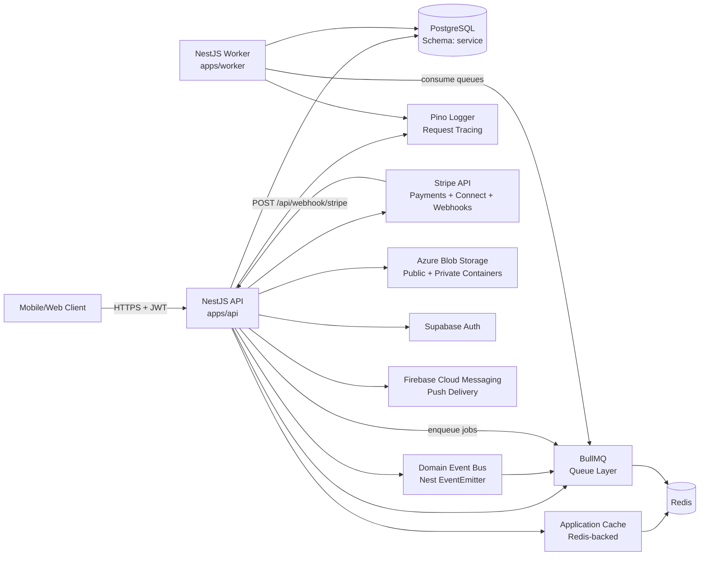
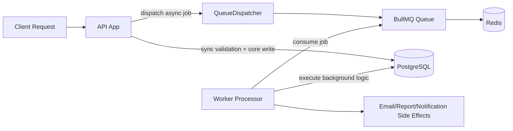
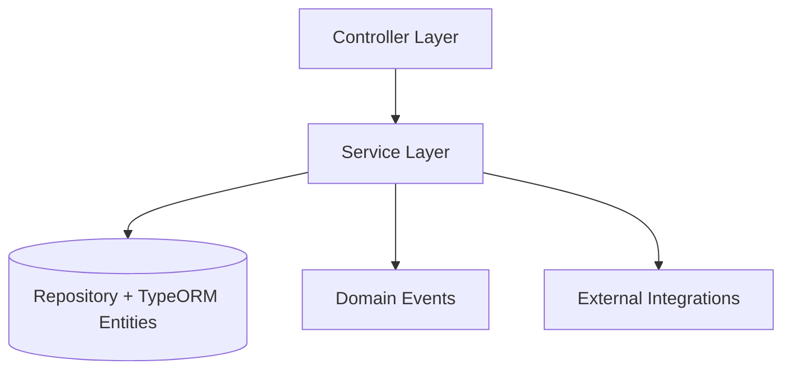

# Architecture Specification

## Purpose
This document explains why the platform is structured this way, how data moves through the system, and which external services are critical to operations.

## System Overview

## Queue Processing Flow

### Queue Flow Steps
1. Request lands on API; synchronous business-critical work is completed first.
2. API publishes deferred work through `QueueDispatcher`.
3. BullMQ persists the job in Redis until a worker is available.
4. Worker app processor consumes the job and executes background logic.
5. Retry/backoff policy is applied by BullMQ for retryable failures.
6. Job outcomes are persisted and surfaced through logs/monitoring.

## Architectural Decisions
1. NestJS modular monolith for API
- Why: strong domain separation with low deployment complexity while product scope is still evolving.
- Evidence: `AppModule` composes infra modules plus feature modules.

2. TypeORM + PostgreSQL schema isolation (`service`)
- Why: migration-safe relational integrity for complex cross-entity workflows (jobs, bids, subscriptions, payments).
- Evidence: both runtime DB module and CLI data source set schema and `search_path=service,public`.

3. Stripe for both one-off payments and recurring subscription lifecycle
- Why: unified provider payouts (Connect), compliance burden reduction, and standard webhook lifecycle events.
- Evidence: Stripe payment intents, checkout subscriptions, webhook signature verification.

4. Azure Blob for direct client upload via SAS URLs
- Why: offload binary traffic from API, keep API focused on orchestration and metadata persistence.
- Evidence: `generateUploadSasUrl()` returns upload URL + clean blob URL for DB storage.

5. BullMQ for background and asynchronous processing
- Why: durable Redis-backed job queues with retries/backoff and separation of API request latency from async processing.
- Evidence: `QueueModule` uses `@nestjs/bullmq` for queue registration/dispatch; worker process registers BullMQ processors.

6. In-app notification persistence with optional FCM push delivery
- Why: preserve a durable notification history in the database while enabling real-time device push when Firebase credentials are configured.
- Evidence: notification records are stored in DB first; FCM token registry and multicast delivery are handled by `NotificationService`.

7. Redis-backed application caching
- Why: reduce database load and improve response latency for read-heavy endpoints.
- Evidence: cache module and interceptor/decorators are used for endpoint-level caching and invalidation.

8. Domain events for decoupled side effects
- Why: keep core write transactions focused while allowing async notifications/audit/secondary actions.
- Evidence: feature services emit events through domain event emitter service and handlers/listeners consume them.

9. Structured logging and request correlation
- Why: enable operational observability and debugging across API and worker processes.
- Evidence: Pino logger integration plus request-id middleware and logging interceptor.

10. Strategy-based authentication switch (Supabase vs dev bypass)
- Why: production safety with operational flexibility in non-prod environments.
- Guardrail: `AUTH_BYPASS` is explicitly blocked in production.

## Layering Model

## Operational Context
1. Request pipeline
- Global validation pipe for DTO enforcement.
- Global exception filter for consistent API errors.
- Logging + transform interceptors and request-id middleware for tracing.

2. Webhook handling
- Raw request body is enabled in Nest bootstrap to support Stripe signature verification.
- All Stripe events (payment, card setup, subscription lifecycle, account updates) are handled in a single endpoint: `POST /api/webhook/stripe`.
- Stripe webhooks are hidden from public Swagger endpoints.
- Swagger UI (`/api/docs`) is only enabled when `NODE_ENV !== production`.

3. Reliability and async work
- BullMQ queue infrastructure (backed by Redis) is used by API dispatchers and worker processors.
- Domain events decouple side effects from write paths.

4. Caching behavior
- API endpoints can use cache interceptor/decorators with explicit invalidation for mutable operations.
- Redis acts as the shared backing store for cache and queue infrastructure.

5. Logging and observability behavior
- Request-scoped correlation is enabled through request-id middleware.
- Structured logs are produced in API and worker for easier aggregation and debugging.

6. Notification delivery behavior
- Notifications are persisted regardless of FCM availability.
- Push delivery is best-effort and token hygiene is maintained by removing invalid registration tokens.

## Security and Storage Checklist
Use this as a release-readiness checklist for architecture-level controls.

### Security
- Authentication strategy is explicitly set per environment (Supabase in normal mode; dev bypass disabled in production).
- Role-based authorization is enforced via guards/decorators on privileged endpoints.
- Stripe webhooks validate signatures against the configured webhook secret.
- Raw request body support is enabled for webhook signature verification.
- Request tracing is enabled (request ID + structured logs).
- Sensitive admin actions and moderation paths have auditable records.

### Storage
- Blob uploads use short-lived SAS URLs (client uploads directly to storage).
- Only clean blob URLs are stored in database records (not SAS query strings).
- Public and private container responsibilities are defined and documented.
- Private blob access is time-bound via read SAS URLs.
- Environment defaults and runtime storage config values are aligned across validation and namespace config.

## Key Risks and Trade-offs
1. Webhook idempotency
- Risk: duplicate Stripe webhook deliveries can create duplicate side effects.
- Current observation: payment completion path creates records but no explicit event-id dedupe table is visible.

2. Financial precision
- Risk: fee/tax calculations in integer/cents pipelines can drift if not normalized at boundaries.
- Recommendation: codify money arithmetic conventions in a dedicated finance utility and tests.

3. Auth strategy drift across environments
- Risk: behavior differences between Supabase and bypass mode.
- Mitigation: keep smoke tests in both modes and enforce production env policy in CI.
