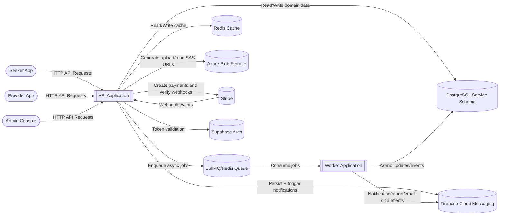

# Data Flow Diagram (Level 1)

This DFD shows how data moves across clients, API, storage, queueing, worker, and external systems.

## Primary Data Stores
- PostgreSQL: source of truth for transactional domain data.
- Redis cache: fast read path for frequently requested resources.
- Redis queue: BullMQ job state and dispatch.
- Azure Blob: large file objects and evidence media.

## Primary Data Flows
1. Request/response flow: client -> API -> DB/cache -> client.
2. Async flow: API -> queue -> worker -> side effects/data updates.
3. File flow: API issues SAS URL -> client uploads directly to Blob -> API stores Blob URL metadata.
4. Payment flow: API creates payment intent -> Stripe callback webhook -> API persists payment result.
