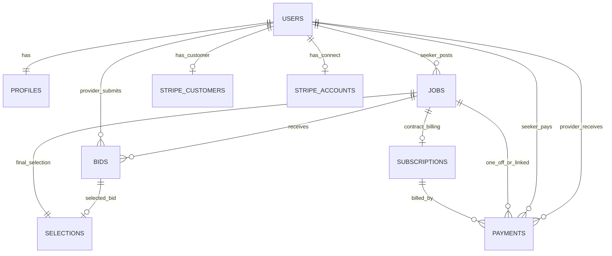

# Domain / Data Model Specification

## Scope
Primary relational model for marketplace operations: users, jobs, bids, selections, subscriptions, and payments.

Full schema ERD (split into readable domain views) is available in [erd-full.md](erd-full.md).

## ERD (Core)

## Key Business Rules in Schema
1. Single subscription per job
- Constraint: `subscriptions.job_id` is unique.
- Consequence: a job cannot have multiple active subscription rows.

2. Optional Stripe subscription ID with uniqueness when present
- Constraint: partial unique index on `stripe_subscription_id` where value is not null.
- Consequence: allows placeholder incomplete subscription rows before checkout completes.

3. Selection uniqueness per job
- Constraint: `selections.job_id` unique.
- Consequence: exactly one selected provider/bid per job lifecycle.

4. Conversation model
- Constraint: unique `(seeker_id, provider_id)` pair in `conversations`.
- Consequence: one canonical thread per seeker-provider pair.

5. Service schema isolation
- Runtime and migration paths target PostgreSQL schema `service` with explicit `search_path`.

## Status and Enum Catalog

### Roles
- `UserRole`: `seeker`, `provider`, `admin`

### Job
- `JobType`: `bidding`, `direct`
- `JobStatus`: `posted`, `bidding`, `selected`, `pending`, `rejected`, `in_progress`, `completed`, `cancelled`

### Bid
- `BidStatus`: `submitted`, `declined`, `accepted`, `selected`

### Subscription and Billing
- `EngagementType`: `single`, `short`, `long`
- `BillingType`: `monthly`, `upfront`
- `SubscriptionStatus`: `incomplete`, `trialing`, `active`, `past_due`, `canceled`, `unpaid`
- `ConnectFlow`: `destination`, `sct`

### Payment
- `PaymentStatus`: `pending`, `succeeded`, `failed`, `refunded`, `disputed`, `canceled`
- `TransactionType`: `payment`, `refund`

### Verification and Compliance
- `VerificationStatus`: `pending`, `submitted`, `under_review`, `approved`, `rejected`
- `VerificationStepType`: `BUSINESS`, `IDENTITY`, `SELFIE`, `RIGHT_TO_WORK`, `POLICE_CHECK`
- `RejectionReason`: `INCOMPLETE_DOCUMENTS`, `DOCUMENT_NOT_VALID`, `SUSPECTED_FRAUD`, `OTHER`

## Notable Data-Flow Anchors
1. Contract creation writes `job_contracts` and a placeholder `subscriptions` row (`INCOMPLETE`).
2. Successful payment webhooks persist payment ledger entries with `SUCCEEDED` status.
3. Verification files are persisted as URL metadata and linked to verification steps.

## Suggested Next Iteration
1. Add field-level data retention and PII classification matrix for compliance review.
