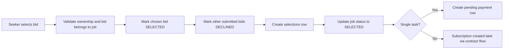

# Flow Spec: Bidding and Selection

## Goal
Describe how providers bid on seeker jobs and how a single winner is selected with transactional consistency.

## Bidding Flow
1. Provider submits bid on a job.
2. Service validates provider profile completeness before accepting bid.
3. Bid is stored in `submitted` state and `BidCreatedEvent` is emitted — seeker is notified ("New bid received").
4. Provider can revise their bid; `BidUpdatedEvent` is emitted — seeker is notified ("Bid revised").
5. Seeker can directly decline a bid; `BidStatusChangedEvent(DECLINED)` is emitted — provider is notified.
6. Provider can list own bids with filtering by status/location/category/price/month/year.

## Selection Flow

## Invariants
1. Only the job seeker can select a bid.
2. Only `submitted` bids can be selected.
3. Non-winning submitted bids are downgraded to `declined` in the same transaction.
4. For single-task jobs, a pending payment placeholder is created at selection time.

## Data and Events
- Tables: `bids`, `selections`, `jobs`, `payments`.
- Events: `SelectionCreatedEvent`, `BidStatusChangedEvent`, `BidCreatedEvent`, `BidUpdatedEvent`.

## Operational Notes
1. Selection path is transaction-wrapped to prevent partial state.
2. Financial amount conversion in selection uses decimal dollars to integer cents conversion.
