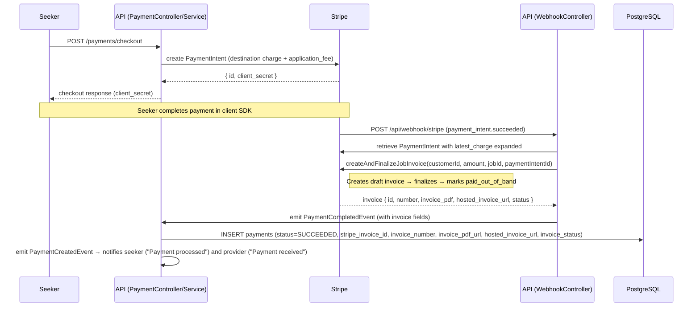
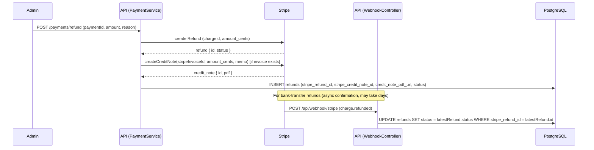
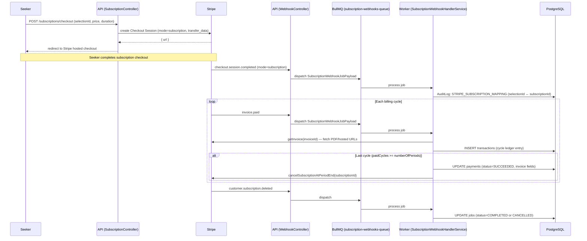

# Flow Spec: Payment and Billing

## Goal
Describe how one-off job payment, refund/credit note, and subscription billing are orchestrated with Stripe and persisted locally.

---

## One-Off Job Payment Flow

### Why standalone invoice instead of invoice_creation on checkout?
Stripe's `invoice_creation` flag on checkout sessions is incompatible with `transfer_data` (Stripe Connect destination charges). The invoice is therefore created post-payment using `paid_out_of_band: true`, which marks it as paid without re-charging the customer.

### Payment record fields written at settlement
| Field | Source |
|---|---|
| `stripe_payment_intent_id` | PaymentIntent ID |
| `stripe_charge_id` | latest_charge.id |
| `stripe_transfer_id` | charge.transfer |
| `balance_transaction_id` | charge.balance_transaction |
| `receipt_url` | charge.receipt_url |
| `stripe_invoice_id` | Invoice ID |
| `invoice_number` | Invoice number (e.g. `INV-0001`) |
| `invoice_pdf_url` | PDF download URL |
| `hosted_invoice_url` | Hosted invoice page URL |
| `invoice_status` | `paid` |
| `amount` | PaymentIntent amount / 100 (dollars) |
| `platform_fee` | application_fee_amount / 100 |
| `provider_amount` | transfer_data.amount / 100 |
| `tax_gst_amount` | metadata.tax_gst_amount / 100 |

---

## Refund and Credit Note Flow

### Credit note behaviour
- A Stripe Credit Note is created only when the payment has a `stripe_invoice_id` (i.e. the invoice was created during settlement).
- Credit note creation is non-fatal: if it fails, the refund record is still created without `stripeCreditNoteId`.
- The `charge.refunded` webhook handles asynchronous confirmation from banks; it updates the local refund status without reprocessing.

---

## Subscription Billing Flow

### Per-cycle invoice fields (last cycle only)
On the final billing cycle, these fields are written to the contract-level `Payment` record:

| Field | Source |
|---|---|
| `stripe_invoice_id` | Stripe invoice ID for the last cycle |
| `invoice_number` | Invoice number |
| `invoice_pdf_url` | PDF URL |
| `hosted_invoice_url` | Hosted page URL |
| `invoice_status` | e.g. `paid` |

### Idempotency
Subscription webhook jobs are deduplicated using `AuditLog` records with action `STRIPE_WEBHOOK_PROCESSED`. Before processing, `isWebhookProcessed(stripeEventId)` is checked; after success, `markWebhookProcessed()` writes the guard record.

---

## Webhook Event Routing Summary

| Stripe Event | Handler | Processing |
|---|---|---|
| `payment_intent.succeeded` | `WebhookController` | Synchronous — charge retrieval + invoice creation + emit event |
| `charge.refunded` | `WebhookController` | Synchronous — update refund status |
| `checkout.session.completed` (setup) | `WebhookController` | Synchronous — save card |
| `checkout.session.completed` (subscription) | `WebhookController` → Queue | Async via BullMQ |
| `invoice.paid` | `WebhookController` → Queue | Async via BullMQ |
| `invoice.payment_failed` | `WebhookController` → Queue | Async via BullMQ |
| `customer.subscription.updated` | `WebhookController` → Queue | Async via BullMQ |
| `customer.subscription.deleted` | `WebhookController` → Queue | Async via BullMQ |
| `account.updated` | `WebhookController` | Synchronous — StripeService handler |

---

## Business State Anchors
- `PaymentStatus.SUCCEEDED` is set only after webhook-driven confirmation (`payment_intent.succeeded` for one-off; last `invoice.paid` cycle for subscriptions).
- Invoice PDF is available on the payment record after `SUCCEEDED`.
- Credit note PDF is available on the refund record after a successful refund with an existing invoice.

## Admin Payment APIs

| Endpoint | Description | Response |
|---|---|---|
| `GET /admin/payments/summary` | Platform revenue (`SUM platform_fee`), transaction count, total refunded | `AdminPaymentSummaryDto` |
| `GET /admin/payments` | Paginated transaction list (payments + refunds UNION) | `PaginatedResponseDto<AdminTransactionListItemDto>` |
| `GET /admin/exports/payments.csv` | All transactions as base64-encoded CSV + filename | `{ data: string, filename: string }` |

Query params for `GET /admin/payments`: `page`, `limit`, `type` (`payment` \| `refund`), `startDate`, `endDate`.

CSV columns: `Transaction ID, Type, Sender, Email, Amount, Currency, Date`.

## Risks and Improvements
1. `payment_intent.succeeded` has no event-ID deduplication guard — a duplicate delivery would create a second invoice. Add `stripeEventId` check in AuditLog before processing.
2. Invoice creation failure is non-fatal and only warns — consider a dead-letter or retry path for invoice creation if the payment record needs the PDF for compliance.
