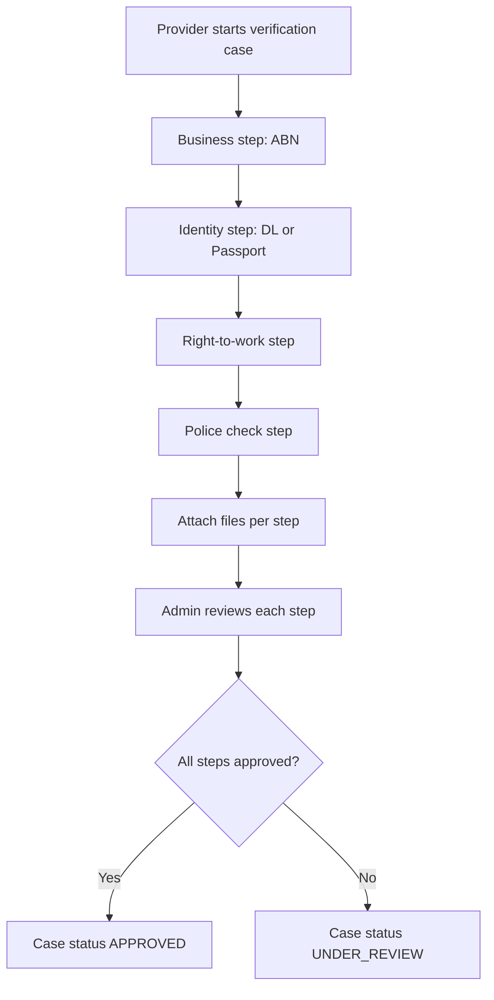

# Flow Spec: Provider Onboarding and Verification

## Goal
Document how providers become operationally ready: profile completion, verification evidence, and payout readiness.

## KYC / Verification Steps

## Narrative
1. Provider endpoints under verification module are role-protected (`PROVIDER`).
2. A verification case is created lazily on first submission.
3. Each step is created idempotently (`getOrCreateStep`) and updated as provider submits data.
4. File attachment replaces existing file for that step and records storage provider metadata.
5. Admin reviews step-by-step and sets approval/rejection with optional reason/note.
6. `VerificationStepReviewedEvent` is emitted — the **provider** is push-notified ("Verification approved" or "Verification rejected" with reason).
7. Case status is recalculated from all step outcomes.

## Stripe Connect Readiness
1. Provider creates or links Stripe Connect account details through payment/billing flows.
2. Connect status endpoint exposes `detailsSubmitted`, `chargesEnabled`, `payoutsEnabled`, and requirement lists.
3. This enables operational go/no-go checks before payout-relevant work starts.

## Storage Context
1. Verification files are expected in private storage paths.
2. Access to private files should be mediated via short-lived read SAS URLs.

## Operational Recommendations
1. Add explicit onboarding checklist endpoint that combines verification + connect readiness into one payload.
2. Track SLA timers for pending verification review to prevent onboarding stalls.
